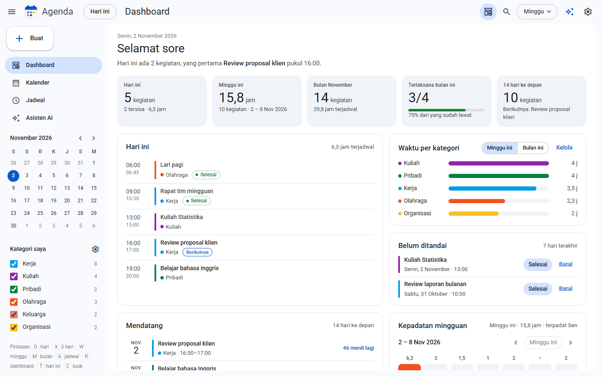
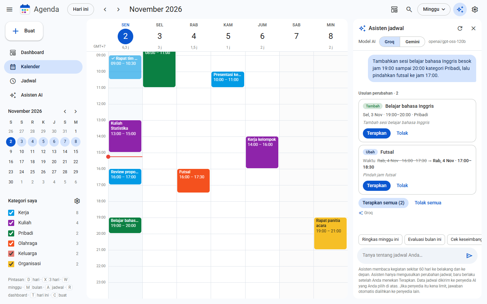
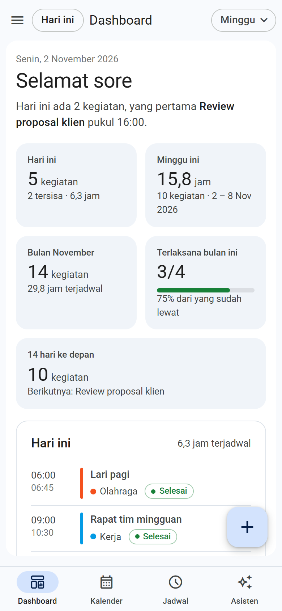
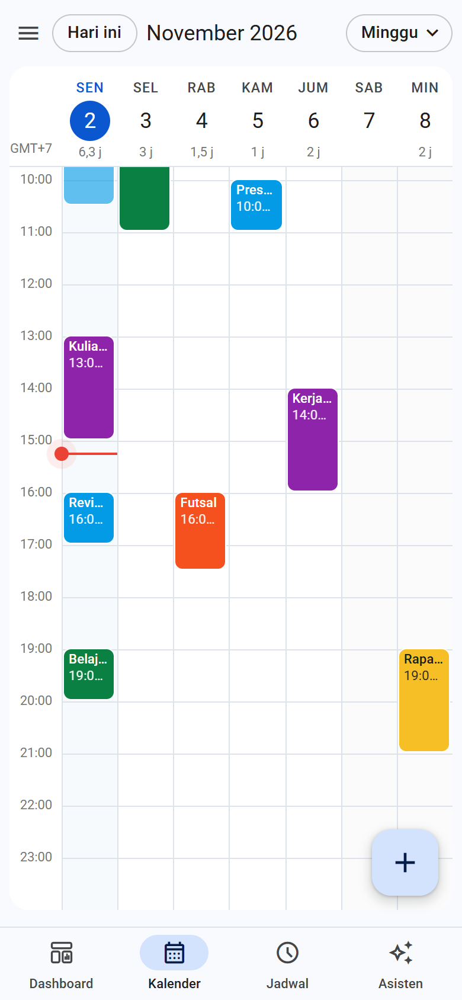

# Agenda Saya

Kalender pribadi dengan tampilan ala **Google Calendar**, lengkap dengan dashboard dan **asisten AI** yang bisa menganalisis jadwal dan mengusulkan perubahan (tambah, ubah, hapus) yang baru berlaku setelah Anda menekan **Terapkan**.

Berjalan gratis di **Vercel** (frontend + API), data di **Supabase** (Postgres), AI dari **Groq** dan/atau **Google AI Studio (Gemini)**.

| Dashboard | Kalender + Asisten AI |
|---|---|
|  |  |

| HP: Dashboard | HP: Kalender |
|---|---|
|  |  |

## Daftar isi
- [Fitur](#fitur)
- [Cara kerja](#cara-kerja)
- [Mulai cepat (lokal)](#mulai-cepat-lokal)
- [Menyiapkan Supabase](#menyiapkan-supabase)
- [Variabel lingkungan](#variabel-lingkungan)
- [Deploy ke Vercel](#deploy-ke-vercel)
- [Asisten AI](#asisten-ai)
- [Struktur proyek](#struktur-proyek)
- [Endpoint API](#endpoint-api)
- [Keamanan](#keamanan)
- [Pemecahan masalah](#pemecahan-masalah)
- [Pintasan keyboard](#pintasan-keyboard)

## Fitur

**Kalender**
- Tampilan **Hari, 3 hari, Minggu, Bulan**, dan **Jadwal** (daftar dengan pencarian dan filter periode, kategori, status).
- Klik slot kosong di tampilan hari/minggu untuk membuat kegiatan di jam itu. Geser kiri/kanan di HP untuk pindah periode.
- Kegiatan berulang (harian, hari kerja, mingguan, bulanan), status (direncanakan, selesai, ditunda, dibatalkan), catatan dengan link yang bisa diklik.
- Kategori yang bisa diubah nama dan warnanya, plus filter tampil/sembunyi per kategori.
- Kalender mini, garis "sekarang", tampilan gelap otomatis mengikuti perangkat.

**Dashboard**
- Sapaan dan ringkasan hari ini, kartu statistik (hari ini, minggu ini, bulan ini, tingkat terlaksana, 14 hari ke depan).
- Waktu per kategori, kegiatan yang belum ditandai, daftar mendatang, dan kepadatan mingguan.

**Asisten AI**
- Analisis cepat (ringkasan minggu, evaluasi bulan, keseimbangan, hari terlalu padat, cari waktu kosong) atau tanya bebas.
- Tombol untuk memilih **Groq** atau **Gemini**. Jika penyedia terpilih kena limit atau gagal, jawaban otomatis dialihkan ke penyedia lain.
- **Usulan perubahan jadwal dengan konfirmasi**: AI hanya mengusulkan, Anda menekan Terapkan atau Tolak, dan ada tombol Urungkan.

**HP**
- Tab bar di bawah, dialog berupa bottom sheet, animasi halus yang otomatis mati jika perangkat memilih "kurangi gerakan".

## Cara kerja

```
Browser (public/)  ──►  Vercel Serverless Functions (api/)  ──►  Supabase Postgres
                                   │
                                   └──►  Groq / Gemini  (API key hanya ada di server)
```

- Frontend adalah HTML/CSS/JS biasa tanpa proses build.
- Login memakai satu username dan password (cookie sesi bertanda tangan, `HttpOnly`).
- Database hanya diakses dari server lewat koneksi Postgres langsung, tidak lewat API publik Supabase.

## Mulai cepat (lokal)

Butuh **Node.js 20 atau lebih baru**.

```bash
git clone <url-repo-ini>
cd <nama-folder>
npm install
cp .env.example .env        # Windows PowerShell: Copy-Item .env.example .env
# isi GROQ_API_KEY (dan/atau GEMINI_API_KEY) di .env
npm run dev
```

Buka http://localhost:3000.

- Tanpa `DATABASE_URL`, data disimpan di file `.data/db.json` (cukup untuk mencoba).
- Tanpa `APP_PASSWORD`, login dimatikan (hanya untuk lokal).
- Saat server menyala, baris kedua di terminal menunjukkan status: penyimpanan yang dipakai, penyedia AI yang aktif, dan apakah login aktif.
- Ganti port: `PORT=3001 npm run dev` (PowerShell: `$env:PORT=3001; npm run dev`).

## Menyiapkan Supabase

Aplikasi tidak membuat tabel sendiri. Anda menjalankan file migrasi sekali.

1. **Buat project** di [supabase.com](https://supabase.com) (paket gratis cukup). Catat **password database** yang Anda buat.
2. **Jalankan migrasi.** Buka **SQL Editor** → New query → tempel isi [`supabase/migrations/20261102000000_init_agenda.sql`](supabase/migrations/20261102000000_init_agenda.sql) → **Run**. Muncul "Success. No rows returned" itu normal. Ini membuat tabel `events` dan `settings` dengan RLS aktif (anon key tidak bisa mengakses datanya). Alternatif: `supabase db push` lewat Supabase CLI.
3. **Ambil connection string.** Klik tombol **Connect** di dashboard → tab **Direct** → pilih **Transaction pooler** (port **6543**). Bentuknya:
   ```
   postgresql://postgres.<project-ref>:<PASSWORD>@aws-0-<region>.pooler.supabase.com:6543/postgres
   ```
   - Ganti `[YOUR-PASSWORD]` dengan password database (bukan API key).
   - Gunakan **Transaction pooler**, bukan "Direct connection". Direct connection di paket gratis hanya IPv6 dan tidak bisa dijangkau dari Vercel.
   - Jika password mengandung karakter khusus (`@ # / ?`), ubah ke bentuk URL-encoded, atau buat password baru yang hanya huruf dan angka.
4. **Isi `DATABASE_URL`** dengan string itu (di `.env` untuk lokal, di Vercel untuk deploy).

Anda **tidak** memerlukan publishable key, secret key, atau `supabase-js`. Cara memeriksa: setelah `npm run dev`, baris kedua di terminal harus berbunyi `Penyimpanan: Postgres (DATABASE_URL)`. Tambah satu kegiatan lalu lihat di **Table Editor → events**.

Skema: dua tabel. `events` menyimpan satu baris per kegiatan (kolom `data` bertipe jsonb), dan `settings` menyimpan pengaturan (daftar kategori di baris `key = 'cats'`).

## Variabel lingkungan

Salin [`.env.example`](.env.example) menjadi `.env`. File `.env` tidak ikut ke Git.

| Variabel | Wajib? | Keterangan |
|---|---|---|
| `DATABASE_URL` | Di Vercel: ya | Connection string Supabase (Transaction pooler). Kosong di lokal = pakai `.data/db.json`. `POSTGRES_URL` juga dibaca sebagai cadangan. |
| `APP_USERNAME` | Disarankan | Username login. Jika kosong, hanya password yang dicek. |
| `APP_PASSWORD` | Di Vercel: ya | Kata sandi login. Di Vercel, server menolak semua permintaan jika ini kosong. |
| `AUTH_SECRET` | Disarankan | String acak panjang untuk menandatangani cookie sesi (`openssl rand -hex 32`). |
| `AI_PROVIDER` | Tidak | `groq` (default) atau `gemini`. Pengguna bisa menggantinya lewat tombol di panel Asisten. |
| `GROQ_API_KEY` | Salah satu AI | Dari [console.groq.com/keys](https://console.groq.com/keys). |
| `GROQ_MODEL` | Tidak | Default `llama-3.3-70b-versatile`. |
| `GEMINI_API_KEY` | Salah satu AI | Dari [aistudio.google.com/apikey](https://aistudio.google.com/apikey). |
| `GEMINI_MODEL` | Tidak | Default `gemini-2.5-flash`. |
| `PORT` | Tidak | Hanya untuk server lokal (default 3000). |

## Deploy ke Vercel

1. **Push** repo ini ke GitHub.
2. Di [vercel.com](https://vercel.com): **Add New → Project** → pilih repo ini.
   - **Framework Preset:** `Other`
   - **Build Command** dan **Output Directory:** biarkan kosong/default ([`vercel.json`](vercel.json) sudah mengaturnya).
3. Buka **Settings → Environment Variables** dan isi, minimal:
   - `DATABASE_URL`, `APP_USERNAME`, `APP_PASSWORD`, `AUTH_SECRET`
   - `GROQ_API_KEY` dan/atau `GEMINI_API_KEY` (beserta `GROQ_MODEL` / `GEMINI_MODEL` jika ingin model lain)
4. **Deploy**. Setiap kali Anda mengubah environment variable, lakukan **Redeploy** agar terbaca.
5. Pastikan [migrasi Supabase](#menyiapkan-supabase) sudah dijalankan.

File `.env` tidak ikut ter-upload, jadi semua nilai harus diisi di Vercel.

## Asisten AI

**Alur usulan perubahan**

```
Anda: "Pindahkan rapat tim besok jadi jam 14:00 dan hapus futsal Kamis"
  │
  ├─(1) browser kirim pesan + daftar kegiatan  ─►  /api/ai  ─►  Groq / Gemini
  ├─(2) AI membalas teks + usulan terstruktur  ◄─  /api/ai  ◄─
  ├─(3) tampil kartu:  [Ubah] Rapat tim  09:00 → 14:00   [Terapkan] [Tolak]
  └─(4) hanya setelah Anda klik Terapkan  ─►  /api/events  ─►  Supabase
```

AI tidak punya jalan untuk menulis ke database sendiri. Setiap kartu bisa diterapkan, ditolak, atau (setelah diterapkan) diurungkan. Kartu menampilkan peringatan jika jamnya bentrok. Menghapus kegiatan berulang hanya menghapus satu kegiatan yang dipilih, bukan seluruh seri.

**Memilih Groq atau Gemini**

| | Groq | Google AI Studio (Gemini) |
|---|---|---|
| Kecepatan | Sangat cepat | Cepat |
| Batas pemakaian paket gratis | Batas token per menit relatif kecil | Umumnya lebih longgar |
| Konteks | Besar | Sangat besar |

Batas gratis sering berubah, jadi cek halaman limit resmi masing-masing ([Groq](https://console.groq.com/docs/rate-limits), [Google AI Studio](https://ai.google.dev/gemini-api/docs/rate-limits)). Isi kedua key agar ada cadangan otomatis. Perlu diingat: daftar kegiatan Anda dikirim ke penyedia AI yang dipilih, jadi tinjau kebijakan data masing-masing, terutama untuk paket gratis.

Prompt memuat maksimal 250 kegiatan terdekat (60 hari ke belakang dan ke depan) supaya tetap muat di batas token paket gratis.

## Struktur proyek

```
api/        auth.js  state.js  events.js  cats.js  ai.js     Vercel Serverless Functions
lib/        http.js  auth.js   store.js   ai.js               logika bersama
public/     index.html  style.css  app.js  favicon.svg        frontend (tanpa build)
supabase/   migrations/*.sql                                   skema database
docs/       screenshots/                                       gambar untuk README
dev-server.js                                                  server lokal yang meniru Vercel
vercel.json                                                    konfigurasi Vercel
```

## Endpoint API

| Endpoint | Fungsi |
|---|---|
| `GET /api/auth` | Status login. `POST` untuk masuk (`{username, password}`), `DELETE` untuk keluar. |
| `GET /api/state` | Semua kegiatan dan daftar kategori. |
| `POST /api/events` | Simpan/ubah kegiatan: `{events: [...]}` (maks. 500). `DELETE` dengan `{ids: [...]}` untuk menghapus. |
| `PUT /api/cats` | Simpan daftar kategori: `{cats: [...]}`. |
| `GET /api/ai` | Daftar penyedia AI yang tersedia dan modelnya. |
| `POST /api/ai` | Kirim percakapan, balasan berupa stream NDJSON (`text` dan `actions`). |

Endpoint data (`state`, `events`, `cats`, `ai`) meminta login jika `APP_PASSWORD` diisi, dan semua data yang masuk divalidasi di server.

## Keamanan

- **Selalu isi `APP_PASSWORD` di deploy.** Di Vercel, server menolak semua permintaan data jika kosong, supaya kalender dan kuota AI Anda tidak terbuka untuk umum.
- API key AI dan `DATABASE_URL` hanya ada di server. Browser tidak pernah menerimanya.
- RLS Supabase aktif tanpa policy, jadi anon key tidak bisa membaca atau menulis tabel.
- Jangan meng-commit `.env`. File itu sudah ada di `.gitignore`. Jika sebuah key pernah tertulis di tempat umum, buat key baru dan hapus yang lama.
- Isi catatan kegiatan ikut dibaca AI. Karena semua perubahan wajib lewat tombol Terapkan, catatan berisi instruksi jahat tidak bisa mengubah jadwal tanpa persetujuan Anda. Tetap baca kartu usulan sebelum menerapkan.

## Pemecahan masalah

| Gejala | Penyebab dan solusi |
|---|---|
| Terminal menampilkan `Penyimpanan: .data/db.json` padahal ingin Supabase | `DATABASE_URL` di `.env` masih kosong, file belum disimpan, atau server belum di-restart. Isi, simpan, lalu Ctrl+C dan `npm run dev` lagi. |
| "Tidak bisa terhubung ke database" | Password salah, atau bukan string Transaction pooler (port 6543). Di terminal server akan ada baris `[db] 28P01` untuk password salah. Reset password di dashboard Supabase lalu perbarui `DATABASE_URL`. |
| "Tabel database belum ada" | Migrasi belum dijalankan. Jalankan file SQL di SQL Editor Supabase. |
| "APP_PASSWORD belum diatur di Vercel" | Isi `APP_USERNAME` dan `APP_PASSWORD` di Environment Variables, lalu Redeploy. |
| Perubahan environment variable di Vercel tidak berpengaruh | Lakukan **Redeploy**. |
| Banner merah "Jadwal belum bisa dimuat" | Baca pesan di banner, perbaiki penyebabnya, lalu klik **Coba lagi**. |
| Tombol Groq atau Gemini nonaktif | API key penyedia itu belum diisi di server. |
| "Batas pemakaian gratis tercapai" | Tunggu sebentar atau pilih penyedia lain. Jika dua-duanya terisi, peralihan terjadi otomatis. |
| "Data jadwal terlalu besar untuk model ini" | Tanyakan hal yang lebih spesifik, atau pakai penyedia dengan batas token lebih besar. |
| Port 3000 sudah terpakai | Jalankan dengan port lain: `PORT=3001 npm run dev`. |

## Pintasan keyboard

| Tombol | Aksi |
|---|---|
| `D` `X` `W` `M` | Tampilan hari, 3 hari, minggu, bulan |
| `A` | Tampilan jadwal (daftar) |
| `R` | Dashboard |
| `T` | Ke hari ini |
| `J` / `K` | Periode berikutnya / sebelumnya |
| `C` | Buat kegiatan |
| `/` | Cari |
| `Esc` | Tutup dialog |
